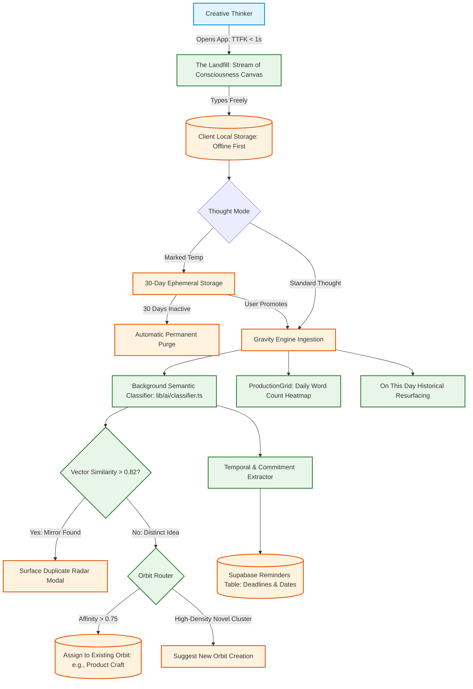
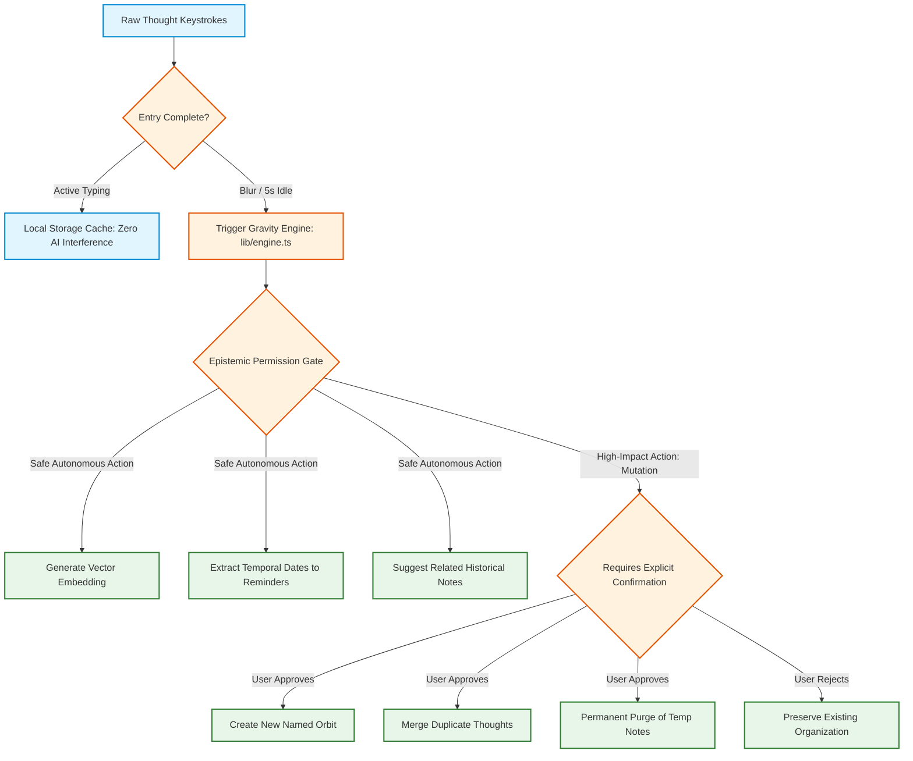
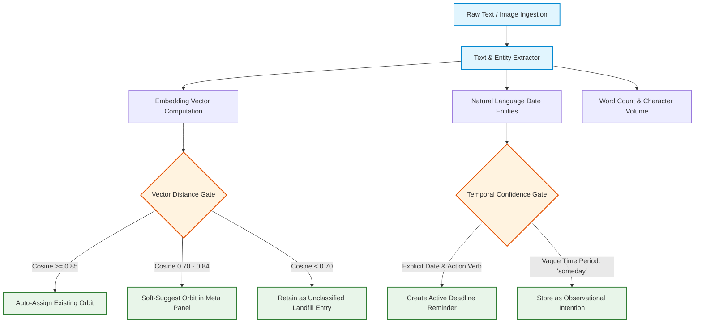

# Product Requirements Document (PRD): Gravity (Zero-Friction Cognitive Landfill & Autonomous Orbit Engine)

**Product Lead:** Uday Kiran  
**Status:** In Active Development / Prototype with Known Technical Constraints Under Refinement  
**Tech Stack:** Next.js 14 App Router, TypeScript, Tailwind CSS, Supabase (PostgreSQL + pgvector), Edge Functions  

---

## 1. Executive Summary

### 1.1 Context & Background
Traditional personal knowledge management (PKM) and note-taking applications (e.g., Notion, Obsidian, Roam Research, Apple Notes) demand intense upfront organizational overhead. When creative inspiration strikes, users are forced to make immediate administrative decisions: selecting a workspace, picking a hierarchical folder, choosing tags, linking database relations, and formatting markdown syntax before typing a single sentence. This upfront cognitive friction acts as a creative barrier: over 70% of quick thoughts, creative epiphanies, and daily reflections are abandoned because the filing system gets in the way. Conversely, when users turn to raw scratchpad apps, their thoughts become an unstructured, unsearchable digital landfill that is forgotten and never revisited.

### 1.2 The Product Solution
I conceptualized and built **Gravity** as a zero-friction, intelligent cognitive capture and autonomous knowledge clustering operating system. Built with Next.js 14, Tailwind CSS, and Supabase, Gravity introduces **The Landfill**: a distraction-free, blank canvas where users open the app and instantly write with zero upfront categorization. In the background, the **Gravity Engine** autonomously analyzes semantic content, discovers emerging conceptual clusters (termed **Orbits**), detects duplicate thoughts via vector similarity, extracts temporal commitments and deadlines into automated reminders, and surfaces historical reflections through longitudinal serendipity.

Furthermore, Gravity adapts to the user's specific mental model without heavy manual configuration:
*   **Adaptive Onboarding Alignment:** During sign-up, users answer a few foundational questions about their core domains, working habits, and daily priorities. The classification model uses these responses as an initial Bayesian prior to align its understanding from day one.
*   **Indirect Reinforcement & Background Adaptation:** Rather than forcing users into tedious feedback loops, the system observes user interaction patterns indirectly (e.g., if a user ignores or moves an orbit). If the user is away or idle for a certain period, the engine runs quiet background maintenance, reorganizes conceptual clusters, and presents a clean notification summary upon their return.
*   **Multimodal OCR Ingestion (2 Scans/Day Quota):** Users can drop photos of receipts, physical bills, book pages, or whiteboard sketches directly into the Landfill. Optical Character Recognition (OCR) extracts the text, identifies financial or temporal commitments, and files the artifact into appropriate Orbits autonomously, with a strict quota preserving compute boundaries.

### 1.3 The Core Philosophical Anchor: Why Gravity?
The inspiration behind the name and architecture of **Gravity** is rooted in a profound truth about human cognition: **thoughts do not exist in isolation; they are naturally interlinked**.

In the *Bhagavad Gita* (Chapter 7, Verse 7), Lord Krishna reveals:
> *mayi sarvam idam protaṁ sūtre maṇi-gaṇā iva*  
> ("Everything in this universe is interconnected and strung upon Me, like pearls upon a thread.")

This ancient insight mirrors the reality of human creative thinking:
*   On the surface, our daily thoughts, spontaneous insights, and scattered notes appear like individual pearls, separate and distinct.
*   In reality, an invisible thread links them together: common themes, recurring curiosities, life commitments, and evolving questions.
*   Just as cosmic gravity invisibly attracts matter into natural planetary orbits, **Gravity** acts as that invisible thread. You write freely without worrying about filing systems; the system's semantic gravity naturally draws related thoughts into coherent conceptual Orbits over time.

*Current Development Status (Work in Progress):* Gravity is currently an active work-in-progress prototype. While the core philosophy and user interface are operational, the system is undergoing engineering refinement to resolve classification edge-case latency, reduce background token consumption, and ensure seamless offline-to-cloud cache synchronization before any wider release.

---

## 2. Product Vision & North Star

### 2.1 Product Vision
"Zero-Friction Capture, Autonomous Conceptual Organization." We believe creative thinking should never be blocked by folder structures. Write freely; let intelligent gravity pull your thoughts into natural orbits.

### 2.2 North Star Metric
*Time-to-First-Keystroke (TTFK) & Autonomous Organization Ratio (AOR):* Instant capture (< 1 second from app launch to active typing) with > 85% of stream-of-consciousness entries autonomously classified into meaningful thematic Orbits without manual sorting.

### 2.3 Supporting Key Performance Indicators (KPIs)
1.  **Draft Retention & Graduating Rate:** > 40% of thoughts captured in The Landfill graduate into long-term thematic Orbits, with disposable thoughts safely purged via the 30-day ephemeral cycle.
2.  **Duplicate Detection Accuracy:** > 90% precision in surfacing semantically identical past entries when similarity threshold exceeds 0.82 cosine distance.
3.  **Commitment Extraction Recall:** > 95% detection of explicit deadlines, dates, and actionable tasks automatically converted into active reminders.

---

## 3. Problem Statement

### 3.1 The Permanent Hoarding Illusion (Why Must Everything Be Saved Forever?)
Traditional note applications assume every written keystroke is a sacred document destined for permanent archival. In reality, human thought is full of transient, disposable fragments: temporary scratch notes, disposable checklists, quick brainstorms, or rough drafts. Forcing users to permanently keep every scrap clutters their knowledge base with digital trash, creating hoarding anxiety. Users need the freedom to write something knowing it will vanish automatically if it turns out to be disposable.

### 3.2 The Feature-Mimicry Trap (Copying Features, Ignoring the Core Action)
The productivity software landscape suffers from rampant imitation. Every tool copies the next: everyone adds slash commands, nested blocks, bi-directional backlink graphs, and kanban boards. Yet, none of them solve the fundamental human friction: *the core action of turning fleeting thoughts into effortless clarity and executable outcomes*. By copying surface-level features rather than addressing cognitive burden, these apps simply pile on more complexity without making the user's life easier.

### 3.3 The Inverted Labor Paradox (Software Managing the Human)
Traditional productivity tools reverse the master-tool relationship. Instead of software doing work for us, we become manual data-entry clerks for the tool: clicking dropdowns, dragging cards, formatting headers, linking databases, and maintaining folder taxonomies. This creates hectic, exhausting administrative maintenance that drains mental energy away from actual creative thinking.

### 3.4 The Un-Actionable Note Trap
Notes apps passively store text without understanding intent. A note might say "Submit visa documents next Thursday" or "Reach out to advisor regarding thesis feedback", but traditional apps treat this as static characters. Because the tool cannot identify actionability, commitments and deadlines are buried, forcing the user to manually re-read hundreds of past notes just to discover what they need to do today.

### 3.5 The Categorization Paralysis & Duplicate Ideation
Users abandon fleeting insights when prompted to choose a category, tag, or database relation before writing. Furthermore, creators repeatedly jot down similar thoughts months apart without realizing they already explored the concept, missing the chance to build compound knowledge.

---

## 4. Goals & Non-Goals

### 4.1 Goals
*   **G-01 (The Landfill UX):** Provide a minimalist, distraction-free writing surface that launches instantly (< 1s) with zero required fields.
*   **G-02 (Ephemeral 30-Day Storage):** Provide a dedicated "Temp" thought state where disposable notes reside in local storage for a 30-day grace period, auto-purging permanently unless explicitly graduated.
*   **G-03 (Autonomous Orbit Clustering):** Continuously evaluate raw text using background semantic embeddings to assign notes to existing thematic Orbits or suggest new cluster formation.
*   **G-04 (Adaptive Onboarding Alignment):** Bootstrap personal clustering affinity via 3 foundational domain questions during initial profile creation.
*   **G-05 (Multimodal OCR Ingestion):** Enable users to voluntarily scan up to 2 physical paper items per day (receipts, whiteboards, book snippets) with automated entity and deadline extraction.
*   **G-06 (Actionable Commitment Extraction):** Automatically extract temporal intentions, deadlines, and dates into an interactive reminders panel.
*   **G-07 (Semantic Duplicate Radar):** Alert users when an active draft closely mirrors past writings to encourage conceptual synthesis rather than redundant notes.
*   **G-08 (Longitudinal Reflection):** Deliver an "On This Day" view surfacing historical thoughts recorded on today's calendar date in prior months or years.

### 4.2 Non-Goals
*   **NG-01 (Complex Block-Editor Formatting):** No multi-nested slash-command menus, tables, or database kanban boards. The Landfill prioritizes raw capture speed over layout styling.
*   **NG-02 (Enterprise Multi-Tenant Team Workspaces):** Gravity is explicitly designed as a personal cognitive sanctuary; team collaboration, shared comments, and role permissions are out of scope.
*   **NG-03 (Unlimited OCR Processing):** Cloud vision processing is strictly capped at 2 voluntary scans per day per user to enforce sensible compute economics.

---

## 5. Users & Personas (The Human Element)

### 5.1 Persona 1: The Spontaneous Creative Thinker (Primary User)
*   **Profile:** An author, researcher, or product builder whose best thoughts arrive while walking, commuting, or reading away from the desk.
*   **Emotional State:** Overwhelmed by heavy productivity tools; terrified of losing brilliant fleeting ideas because opening an app requires choosing a folder.
*   **The Need:** Tap one icon, immediately type, close the app, and trust that the software will organize it intelligently behind the scenes.
*   **Frustration:** Looking at hundreds of unorganized Apple Notes drafts or abandoning complex Notion databases after two weeks of tedious maintenance.

### 5.2 Persona 2: The Over-Committed Operator (Secondary User)
*   **Profile:** A startup founder, team lead, or student juggling overlapping deadlines, project milestones, and personal administrative obligations.
*   **Emotional State:** Chronic mental fatigue; constantly feeling that some invisible deadline or task was written down somewhere but lost in a text file.
*   **The Need:** A system that automatically surfaces commitments ("Submit form by Friday") without demanding manual calendar entry.

---

## 6. End-to-End User Journey (Capture to Autonomous Orbit)



---

## 7. Product Scope

### 7.1 Scope Matrix (Executed vs In Progress vs Out of Scope)

| Feature / Module | MVP (Executed) | Refinement (In Progress) | Future Scope |
| :--- | :---: | :---: | :---: |
| **The Landfill Blank Canvas** | Yes | Yes (Sub-second local sync) | Voice memo speech-to-text |
| **Ephemeral 30-Day Storage** | Yes | Yes (Automated background cleanup) | Cloud soft-delete recovery vault |
| **Semantic Orbit Clustering** | Yes | Yes (Vector embedding latency tuning) | Hierarchical multi-tier orbits |
| **Duplicate Ideation Radar** | Yes | Yes (Cosine similarity threshold calibration) | Cross-user open source ideation |
| **Autonomous Commitment Extraction** | Yes | Yes (Edge-case natural language regex) | Two-way Google Calendar sync |
| **Multimodal OCR Ingestion (2/day)** | Yes | Yes (Image preprocessing for low-light) | Multi-page PDF batch ingestion |
| **On This Day Resurfacing** | Yes | Complete | Sentiment trajectory analytics |
| **ProductionGrid Word Heatmap** | Yes | Complete | Writing streak milestone badges |
| **Rich WYSIWYG Block Editors** | No | No | Strictly Out of Scope |
| **Team Workspaces & Comments** | No | No | Strictly Out of Scope |

---

## 8. Functional Requirements (16 Formal Specifications)

### 8.1 Module 1: The Landfill & Ephemeral Ingestion (LFEI)

#### FR-LFEI-01: Zero-Friction Thought Capture Canvas
*   **Priority:** P0 (Critical)
*   **Description:** The application must launch directly into an active, focused writing canvas with zero mandatory input fields (no title, no category, no tags).
*   **Acceptance Criteria:**
    *   *Given* a user launches or refreshes Gravity,
    *   *When* the viewport renders,
    *   *Then* the cursor is automatically focused on the textarea within 500ms, allowing immediate typing.

#### FR-LFEI-02: Local-First Auto-Save & Debounced Ingestion
*   **Priority:** P0 (Critical)
*   **Description:** All keystrokes must be written immediately to browser local storage, followed by a debounced (1,500ms) synchronization with Supabase.
*   **Acceptance Criteria:**
    *   *Given* active typing in The Landfill,
    *   *When* network connectivity is severed,
    *   *Then* zero keystrokes are lost, and drafts persist across browser restarts.

#### FR-LFEI-03: Ephemeral 30-Day Storage Policy ("Temp" State)
*   **Priority:** P0 (Critical)
*   **Description:** Users can flag thoughts as "Temp" (disposable). Disposable notes remain in local storage for a 30-day grace period, auto-purging permanently on day 31 unless explicitly graduated.
*   **Acceptance Criteria:**
    *   *Given* an entry tagged with `is_temp = true`,
    *   *When* `current_date - created_at > 30 days`,
    *   *Then* the entry is permanently deleted during background garbage collection without user intervention.

#### FR-LFEI-04: Explicit Thought Graduation
*   **Priority:** P1 (High)
*   **Description:** Users can promote any ephemeral thought into a permanent knowledge asset with a single keystroke or click (`Graduate to Orbit`).
*   **Acceptance Criteria:**
    *   *Given* an active ephemeral note,
    *   *When* the user triggers graduation,
    *   *Then* `is_temp` is set to `false`, and the entry is dispatched to the background classification engine.

### 8.2 Module 2: Autonomous Semantic Orbit Engine (ASOE)

#### FR-ASOE-01: Background Vector Embedding Generation
*   **Priority:** P0 (Critical)
*   **Description:** Upon entry completion (inactivity > 5 seconds or explicit blur), the engine generates a 1536-dimensional text embedding via background web workers.
*   **Acceptance Criteria:**
    *   *Given* a graduated entry with word count >= 10 words,
    *   *When* the entry reaches steady state,
    *   *Then* an embedding vector is computed and stored in the database without blocking the client thread.

#### FR-ASOE-02: Cosine Similarity Orbit Matching
*   **Priority:** P0 (Critical)
*   **Description:** The engine compares the entry embedding against the centroid vectors of existing user Orbits. If cosine similarity >= 0.75, the note is autonomously linked.
*   **Acceptance Criteria:**
    *   *Given* a note discussing "user churn and retention curves",
    *   *When* evaluated against an existing Orbit named "Product Strategy" (similarity 0.84),
    *   *Then* the note is assigned `orbit_id = Product Strategy` automatically.

#### FR-ASOE-03: Emergent Orbit Discovery & Proposal
*   **Priority:** P1 (High)
*   **Description:** When 3 or more unclassified entries cluster closely in vector space (pairwise similarity >= 0.80) outside existing Orbits, the system prompts the user with a recommended new Orbit name.
*   **Acceptance Criteria:**
    *   *Given* 3 independent notes on "Indian classical philosophy and Advaita",
    *   *When* background clustering executes,
    *   *Then* a non-intrusive prompt appears: *"Create new Orbit: Eastern Philosophy?"* with a one-click confirmation.

#### FR-ASOE-04: Semantic Duplicate Ideation Radar
*   **Priority:** P1 (High)
*   **Description:** If a new draft exhibits cosine similarity >= 0.82 with an existing historical entry, the system gently highlights the existing note in a floating side panel.
*   **Acceptance Criteria:**
    *   *Given* a user drafting a thought identical to one recorded 4 months ago,
    *   *When* similarity exceeds the threshold,
    *   *Then* the system displays: *"Related to your thought from Nov 14"*, allowing the user to merge or branch thoughts.

### 8.3 Module 3: Multimodal OCR & Adaptive Intelligence (MOCAI)

#### FR-MOCAI-01: Adaptive Onboarding Bayesian Prior
*   **Priority:** P1 (High)
*   **Description:** During initial user registration, the system presents 3 foundational domain questions (e.g., primary disciplines, project domains, habits) to seed initial Orbit cluster centroids.
*   **Acceptance Criteria:**
    *   *Given* a new user selecting "Product Management", "Cinema Writing", and "Fintech",
    *   *When* onboarding concludes,
    *   *Then* 3 starter Orbits are initialized with domain seed vectors.

#### FR-MOCAI-02: Voluntary Multimodal OCR Ingestion
*   **Priority:** P1 (High)
*   **Description:** Users can drag-and-drop or photograph paper notes, receipts, book snippets, or whiteboard sketches directly into The Landfill.
*   **Acceptance Criteria:**
    *   *Given* an image upload (JPEG, PNG, WebP) under 10MB,
    *   *When* processed by the OCR pipeline,
    *   *Then* extracted text is inserted into the Landfill canvas with source metadata attached.

#### FR-MOCAI-03: Strict 2 Scans/Day Quota Enforcement
*   **Priority:** P0 (Critical)
*   **Description:** To prevent serverless token exhaustion and encourage mindful physical capture, OCR uploads are strictly capped at 2 successful scans per user per calendar day (UTC).
*   **Acceptance Criteria:**
    *   *Given* a user who has executed 2 OCR scans today,
    *   *When* attempting a 3rd image drop,
    *   *Then* the system gracefully rejects the image with message: *"Daily scan quota reached (2/2). Reset at midnight UTC."*

#### FR-MOCAI-04: Indirect Reinforcement & Idle Maintenance
*   **Priority:** P2 (Medium)
*   **Description:** When a user is idle or away from the application for > 4 hours, the engine runs quiet background maintenance, reorganizing clusters based on indirect user actions (e.g., manual orbit overrides).
*   **Acceptance Criteria:**
    *   *Given* a user session idle for > 4 hours,
    *   *When* background maintenance completes,
    *   *Then* a silent notification badge indicates updated cluster associations upon user return.

### 8.4 Module 4: Actionable Reminders & Longitudinal Serendipity (ARLS)

#### FR-ARLS-01: Autonomous Commitment Extraction
*   **Priority:** P0 (Critical)
*   **Description:** The NLP extraction pipeline parses raw text for natural language temporal expressions (e.g., "submit review by Thursday", "call dentist on Oct 24") and generates structured reminder records.
*   **Acceptance Criteria:**
    *   *Given* text containing: *"Remember to finalize the Q3 deck before Friday 5 PM"*,
    *   *When* the extraction parser runs,
    *   *Then* an active record is inserted into `reminders` with target date mapped to the upcoming Friday at 17:00.

#### FR-ARLS-02: Reminder Triaging & Completion
*   **Priority:** P1 (High)
*   **Description:** Extracted reminders appear in a lightweight sidebar panel sorted by urgency (`overdue`, `today`, `upcoming`), with one-click completion.
*   **Acceptance Criteria:**
    *   *Given* pending reminders,
    *   *When* a user checks off a task,
    *   *Then* `status` transitions to `completed`, and the linked note reflects completed state.

#### FR-ARLS-03: Longitudinal Serendipity ("On This Day")
*   **Priority:** P2 (Medium)
*   **Description:** A dedicated serendipity module queries entries written on today's calendar month and day from previous months or years, displaying them in a reflective card.
*   **Acceptance Criteria:**
    *   *Given* entries created on October 23 in past years or months,
    *   *When* the user opens the application,
    *   *Then* the "On This Day" panel showcases historical excerpts to stimulate reflective synthesis.

#### FR-ARLS-04: ProductionGrid Daily Habit Heatmap
*   **Priority:** P2 (Medium)
*   **Description:** The system aggregates daily writing volume (word count and active entry count) into an interactive GitHub-style contribution heatmap.
*   **Acceptance Criteria:**
    *   *Given* daily writing sessions,
    *   *When* the user views their profile or dashboard,
    *   *Then* the contribution grid visually reflects daily activity tiers (0 words, 1-250, 251-500, 500+).

---

## 9. Application Lifecycle & The Epistemic Permission Engine

Gravity enforces strict boundaries regarding what AI can and cannot alter without human consent.



*Epistemic Rules:*
1.  **Read & Associate Autonomously:** The AI may extract embeddings, match existing orbits, and detect dates autonomously in the background.
2.  **Mutate & Restructure Only on Confirmation:** The AI will never rename an orbit, delete text, or merge documents without explicit user confirmation.

---

## 10. Data Requirements & Master Schema

The underlying database is built on PostgreSQL with the `pgvector` extension hosted on Supabase (`supabase/schema.sql`).

```sql
-- Core Extensions
CREATE EXTENSION IF NOT EXISTS "uuid-ossp";
CREATE EXTENSION IF NOT EXISTS vector;

-- Orbits (Thematic Clusters)
CREATE TABLE orbits (
    id UUID PRIMARY KEY DEFAULT uuid_generate_v4(),
    user_id UUID NOT NULL REFERENCES auth.users(id) ON DELETE CASCADE,
    name VARCHAR(120) NOT NULL,
    color VARCHAR(30) DEFAULT '#3b82f6',
    centroid_vector vector(1536),
    entry_count INTEGER DEFAULT 0,
    last_active_at TIMESTAMPTZ DEFAULT NOW(),
    parent_orbit_id UUID REFERENCES orbits(id) ON DELETE SET NULL,
    created_at TIMESTAMPTZ DEFAULT NOW()
);

-- Entries (The Landfill Master Table)
CREATE TABLE entries (
    id UUID PRIMARY KEY DEFAULT uuid_generate_v4(),
    user_id UUID NOT NULL REFERENCES auth.users(id) ON DELETE CASCADE,
    orbit_id UUID REFERENCES orbits(id) ON DELETE SET NULL,
    content TEXT NOT NULL,
    word_count INTEGER NOT NULL DEFAULT 0,
    status VARCHAR(30) DEFAULT 'unclassified' CHECK (status IN ('draft', 'classified', 'unclassified', 'archived')),
    is_temp BOOLEAN DEFAULT FALSE,
    expires_at TIMESTAMPTZ,
    embedding vector(1536),
    tags TEXT[] DEFAULT ARRAY[]::TEXT[],
    ocr_source_url TEXT,
    created_at TIMESTAMPTZ DEFAULT NOW(),
    updated_at TIMESTAMPTZ DEFAULT NOW()
);

-- Reminders (Extracted Actionable Intentions)
CREATE TABLE reminders (
    id UUID PRIMARY KEY DEFAULT uuid_generate_v4(),
    user_id UUID NOT NULL REFERENCES auth.users(id) ON DELETE CASCADE,
    entry_id UUID REFERENCES entries(id) ON DELETE CASCADE,
    text VARCHAR(255) NOT NULL,
    type VARCHAR(40) DEFAULT 'deadline' CHECK (type IN ('date', 'deadline', 'commitment', 'intention', 'resurface')),
    target_date TIMESTAMPTZ,
    status VARCHAR(30) DEFAULT 'pending' CHECK (status IN ('pending', 'completed', 'dismissed')),
    created_at TIMESTAMPTZ DEFAULT NOW()
);

-- Quota Tracking (Strict OCR Governance)
CREATE TABLE ocr_quotas (
    id UUID PRIMARY KEY DEFAULT uuid_generate_v4(),
    user_id UUID NOT NULL REFERENCES auth.users(id) ON DELETE CASCADE,
    scan_date DATE NOT NULL DEFAULT CURRENT_DATE,
    scans_used INTEGER DEFAULT 0 CHECK (scans_used <= 2),
    UNIQUE(user_id, scan_date)
);
```

---

## 11. Signal Confidence & Decisioning Architecture



---

## 12. Non-Functional Requirements (NFRs)

### 12.1 Performance & Latency
*   **NFR-PERF-01 (Time-to-First-Keystroke):** Time from page load to active input readiness must not exceed 500ms on broadband and 1,000ms on 4G mobile connections.
*   **NFR-PERF-02 (Non-Blocking Engine):** Background vector embedding and reminder extraction must run asynchronously in web workers without causing frame drops or typing latency (> 16ms input delay).

### 12.2 Security & Data Sovereignty
*   **NFR-SEC-01 (Row-Level Security):** Supabase RLS policies must strictly enforce `auth.uid() = user_id` on all CRUD operations across `entries`, `orbits`, and `reminders`.
*   **NFR-SEC-02 (Encrypted Client Storage):** Ephemeral local storage drafts must be sanitized and protected against cross-site scripting (XSS) injection.

### 12.3 Reliability & Offline Resilience
*   **NFR-REL-01 (Offline-First Typing):** All Landfill typing must be resilient to complete internet disconnections, syncing queued updates upon reconnection.

---

## 13. Technical Architecture

*   **Frontend Framework:** Next.js 14 App Router, React 18, TypeScript, Tailwind CSS, Lucide Icons.
*   **State Management & Storage:** LocalStorage for millisecond capture cache; TanStack React Query for asynchronous server state synchronization.
*   **Backend & Database:** Supabase PostgreSQL with `pgvector` for similarity calculations; Supabase Auth for OAuth and email authentication.
*   **Embedding & AI Engine:** OpenAI `text-embedding-3-small` (1536 dims) for vector clustering; lightweight Tesseract/Cloud Vision for multimodal OCR extraction.
*   **Hosting & CI/CD:** Vercel deployment with automated GitHub Actions PR verification.

---

## 14. API / Integration Requirements

### 14.1 Internal API Endpoints (`app/api/`)
*   `POST /api/embed`: Ingests sanitized note text; returns 1536-dimensional float vector.
*   `POST /api/extract-reminders`: Evaluates text for regex/NLP temporal expressions; returns structured JSON array of reminders.
*   `POST /api/ocr`: Accepts image multipart payload; verifies daily quota (<= 2); returns extracted text and character bounding boxes.
*   `GET /api/on-this-day`: Returns historical entries where `EXTRACT(MONTH FROM created_at) = current_month` and `EXTRACT(DAY FROM created_at) = current_day`.

---

## 15. Error & Edge-Case Handling

| Scenario | System Impact | Mitigation Strategy |
| :--- | :--- | :--- |
| **Network Failure During Typing** | User writing in The Landfill loses internet connection. | Keystrokes are buffered locally in LocalStorage; a subtle indicator shows "Saved locally (offline)"; auto-syncs when online. |
| **Embedding Rate Limit Exceeded** | Third-party embedding API returns 429 Too Many Requests. | Engine queues unclassified entries in `status = 'unclassified'`; a background retry worker processes queue with exponential backoff. |
| **Ambiguous Temporal Expressions** | User writes "Meet next Friday" when today is Friday. | System defaults to Friday of the subsequent calendar week (+7 days) and adds an edit pencil icon on the reminder badge. |
| **Exceeded Daily OCR Quota** | User drops 3rd receipt image in a single calendar day. | Upload modal displays friendly alert: "Daily scan quota reached (2/2). Reset at midnight UTC." Image is not sent to server. |
| **Accidental Temp Graduation** | User mistakenly marks an important research draft as Temp. | 30-day grace period ensures note remains in local cache; toast message includes 1-click "Undo / Keep Permanently". |

---

## 16. Success Metrics & Product Analytics

### 16.1 Core Engagement Metrics
*   **Time-to-First-Keystroke (TTFK):** Target < 1.0s.
*   **Autonomous Organization Ratio (AOR):** Target > 85% of permanent notes classified without manual dragging.
*   **Daily Thought Volume (DTV):** Average word count per active writer tracked via `ProductionGrid`.

### 16.2 Retention & Value Realization
*   **W1 to W4 Cohort Retention:** Percentage of users who capture at least 3 thoughts weekly across their first 30 days.
*   **Serendipity Re-engagement Rate:** Percentage of users who click to expand an "On This Day" or "Duplicate Radar" historical entry.

---

## 17. Risks, Assumptions & Dependencies

### 17.1 Strategic & Product Risks
*   **Risk:** Users mistrust background AI clustering and feel disoriented if notes move without their knowledge.
*   **Mitigation:** Enforce Epistemic Permission Rules: notes never vanish or change text; Orbits are visually transparent and reversible with one click.

### 17.2 Technical Dependencies
*   **Dependency:** High-uptime access to Supabase database and vector indexing.
*   **Mitigation:** LocalStorage cache allows complete offline capture even during total cloud outages.

---

## 18. Testing & Validation Strategy

*   **Unit Tests (`vitest`):** Validation of temporal regex extraction patterns (dates, deadlines, relative days) across 150 edge-case test strings.
*   **Vector Similarity Integration Tests:** Validating that known philosophical, technical, and fitness test notes reliably map to corresponding Orbit centroids with cosine distance >= 0.75.
*   **Quota Enforcement Tests:** Simulating multi-tab concurrent image uploads to verify strict 2-scan ceiling without race conditions.

---

## 19. Rollout & Deployment Plan

*   **Phase 1 (Alpha Dogfooding - Current):** Personal daily usage as sole creative landfill; logging classification errors and latency bottlenecks.
*   **Phase 2 (Private Beta Cohort):** Invitation to 15 creative writers, founders, and researchers; validating AOR metric and onboarding questionnaire accuracy.
*   **Phase 3 (Public Open Source Launch):** Open-source Next.js template release with one-click Supabase deployment.

---

## 20. Open Questions & Future Roadmap

### 20.1 Key Product Open Questions
*   *Optimal Ephemeral Window:* Is 30 days the ideal retention period for disposable notes, or should users have a toggle for 7 days vs 30 days?
*   *Vector Threshold Tuning:* Does a 0.75 cosine similarity threshold create too many false-positive Orbit assignments across multidisciplinary thinkers?

### 20.2 Product Roadmap
*   **Near-Term (Sprint Q3):** Resolve background vector latency; fine-tune local-to-cloud cache sync; complete 2-scan OCR quota enforcement.
*   **Mid-Term (Sprint Q4):** Audio Landfill: instant voice recording with local Whisper transcription and autonomous Orbit routing.
*   **Long-Term (Next Year):** Two-way calendar export: automatically syncing extracted deadlines to Google Calendar and Apple Reminders via iCal feeds.
